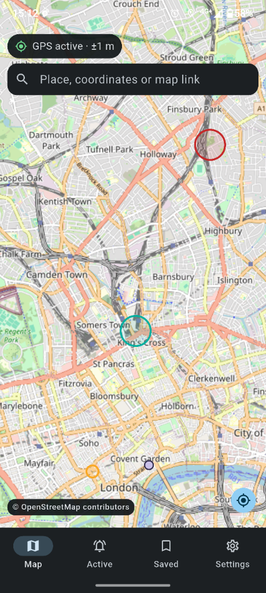
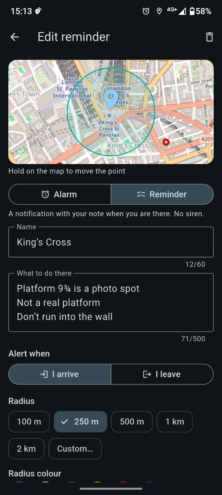
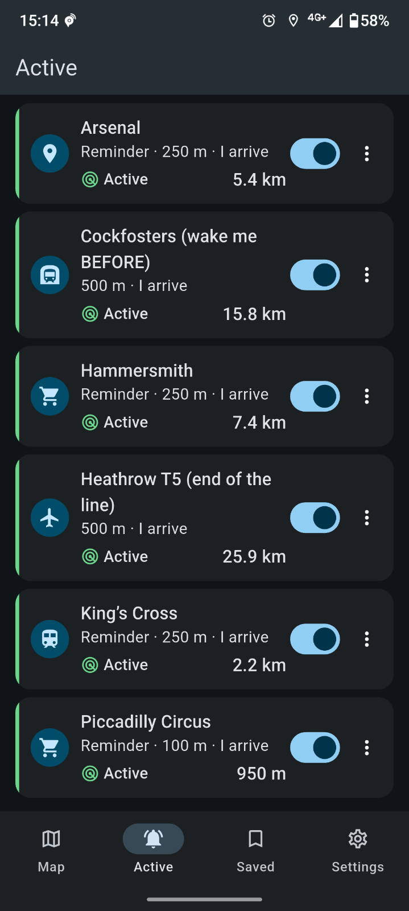
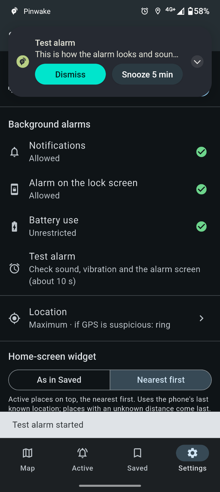
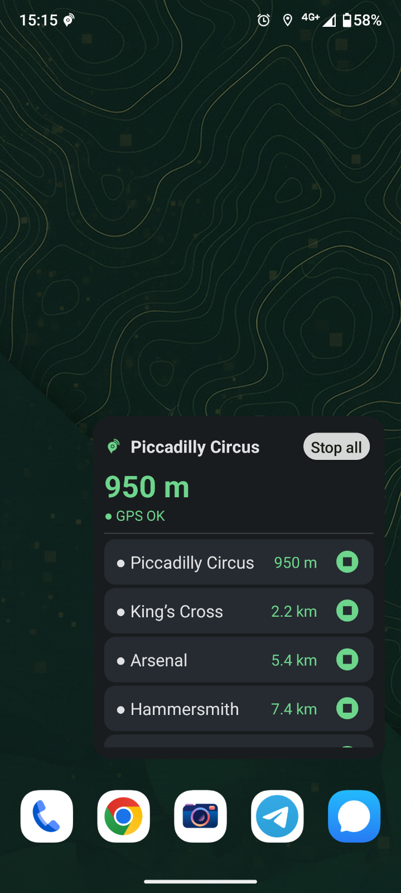
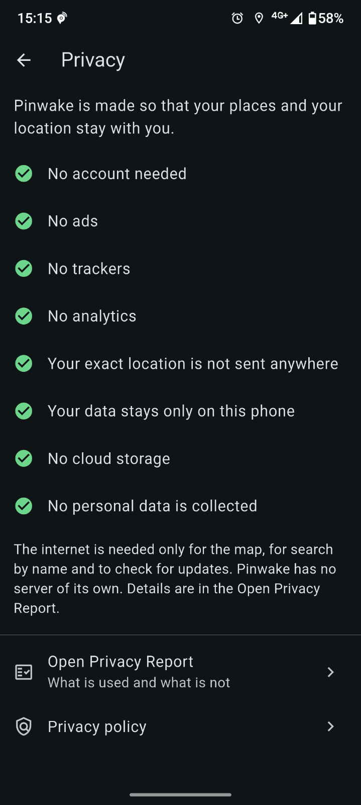

Pinwake
Sleep. We’ll wake you there.
English · Українська
<p align="center">
  
  
  
</p>
<p align="center">
  
  
  
</p>
---
English
Pinwake is an Android alarm that rings where you are, not at a set time. Put a pin on the map, pick a radius, and the phone signals when you get there or when you leave. It suits a stop you tend to sleep through, a station, or a shop you keep forgetting.
It keeps working with the screen off and the app closed. There is no account, no server, no ads and no analytics. Your places and your position stay on the phone.
Download
Get the `.apk` from the latest release. You need Android 8.0 or newer.
When you open the file, Android asks you to allow installs from your browser or file manager. Allow it once. Chrome may say the file "might be harmful" and Google Play Protect may offer to scan it. Both warnings appear for any app installed from outside Google Play, and Pinwake is not on Google Play yet.
The app checks this page at most once a day and tells you when a newer release is out. It never installs anything by itself: you tap Download, get the new file, and Android installs it over the old one. Your places are kept. "Later" hides that version for a week, and the check can be switched off in Settings → Support.
<details>
<summary>How to check the file</summary>
Each release has a `SHA256SUMS.txt`. Put it next to the APK and run:
```
sha256sum -c SHA256SUMS.txt
```
On Windows: `certutil -hashfile pinwake-X.Y.Z-N.apk SHA256` and compare the result with the line in the file.
Every release is signed with the same key. The SHA-256 of its certificate (what `apksigner verify --print-certs` shows):
```
b5a3184c9ea79ed055c7594d09051e8cb475aadc45a944817c29d533580ae52e
```
If it differs, don’t install the file.
</details>
What it does
Places. Tap the map, search by name, or share a place from Google Maps into Pinwake. Pick a radius from the presets or type your own. Ring when you enter the zone or when you leave it.
Two kinds of signal. An alarm has a siren, a full alarm screen and snooze. A reminder is a notification with your note or checklist and a short vibration or sound.
Sound and look. Use a system sound or your own file, with or without vibration. Every place has its own icon and colour.
Lists. Saved places in the order you drag them into, and an Active list that shows the distance to each place.
Widget. A scrollable list of your places on the home screen. Start or stop a place with a tap, or open it on the map.
Bad GPS. One noisy reading doesn’t trigger anything, the app waits for confirmation. It also compares GPS with the network position. If they disagree by a lot (interference, spoofing), GPS is marked as suspicious, and you choose per place whether to ring anyway or stay quiet.
Wi-Fi hint (optional). The app can remember which Wi-Fi networks are around a place, as hashes, and use that when GPS is poor. Network names are never kept.
Fast pass (optional). When you move quickly, one reading inside the zone is enough. Turn it off if it rings too early.
Backup. Save your places to a file and restore them, for example on a new phone. This needs no permissions.
Light and dark theme, 12 interface languages.
Privacy
The map comes from OpenStreetMap. The internet is used for map tiles, for place search (only when you press search) and for the update check. Nothing else leaves the phone. The Privacy center in the app lists every permission and what each one is for. The policy is in PRIVACY.md (Ukrainian and English).
Permissions: location, notifications, and an optional exemption from battery limits. If you choose your own alarm sound from your music library, Android also asks for Music and audio, only to read the file name.
If something goes wrong, Settings → Support can create a diagnostics file. It has no coordinates and no place names. You decide whether to send it, and it goes by your own email.
Worth knowing
GPS is weak indoors, in the metro and between tall buildings. For a car or a tram, use a radius of 250–500 m, not 100.
Some phones limit background apps hard. If the signal comes late, set Pinwake’s battery usage to "unrestricted" in the system settings.
If you force-stop the app, monitoring stops until you open it again.
After an update, the launcher may keep showing the old widget. Remove it and add it again.
When GPS is jammed or spoofed, no method is perfect. A long, steady spoof with no network can still fool the check. For stops that matter, make the radius wider.
Contact
Write to pinwake.dev@gmail.com or open an issue here. The source code is closed for now, and this repository only holds the downloads.
---
Українська
Pinwake — будильник для Android, який дзвонить не о певній годині, а в певному місці. Ставите точку на карті, вибираєте радіус, і телефон подає сигнал, коли ви під’їхали або вийшли із зони. Підходить для зупинки, яку ви звикли проспати, для станції чи для магазину, про який постійно забуваєте.
Працює з вимкненим екраном і закритим застосунком. Без акаунта, без сервера, без реклами й аналітики. Ваші точки та ваше місцеположення лишаються на телефоні.
Завантаження
Файл `.apk` лежить в останньому релізі. Потрібен Android 8.0 або новіший.
Коли відкриєте файл, Android попросить дозволити встановлення з браузера або файлового менеджера. Дозвольте один раз. Chrome може написати, що файл «може бути шкідливим», а Google Play Protect запропонує його просканувати. Обидва попередження з’являються для будь-якого застосунку не з Google Play, а Pinwake там поки що немає.
Застосунок перевіряє цю сторінку не частіше разу на добу й повідомляє, коли вийшла нова версія. Сам нічого не встановлює: ви натискаєте «Завантажити», отримуєте файл, і Android ставить його поверх старого. Точки зберігаються. «Пізніше» ховає цю версію на тиждень, а саму перевірку можна вимкнути в Налаштуваннях → Підтримка.
<details>
<summary>Як перевірити файл</summary>
У кожному релізі є `SHA256SUMS.txt`. Покладіть його поруч з APK і виконайте:
```
sha256sum -c SHA256SUMS.txt
```
У Windows: `certutil -hashfile pinwake-X.Y.Z-N.apk SHA256`, а результат порівняйте з рядком у файлі.
Усі релізи підписані одним ключем. SHA-256 його сертифіката (так його показує `apksigner verify --print-certs`):
```
b5a3184c9ea79ed055c7594d09051e8cb475aadc45a944817c29d533580ae52e
```
Якщо значення інше, файл не встановлюйте.
</details>
Що вміє
Точки. Торкніться карти, знайдіть за назвою або поділіться місцем із Google Maps у Pinwake. Радіус можна взяти з готових або ввести свій. Сигнал при вході в зону або при виході з неї.
Два види сигналу. Будильник — сирена, повний екран будильника й «Відкласти». Нагадування — сповіщення з вашою нотаткою чи списком і короткою вібрацією або звуком.
Звук і вигляд. Системна мелодія або ваш файл, з вібрацією або без. У кожної точки своя іконка й колір.
Списки. «Збережені» у порядку, який ви задали перетягуванням, і список «Активні» з відстанню до кожної точки.
Віджет. Прокручуваний список точок на головному екрані. Запустити чи зупинити точку можна дотиком, а ще відкрити її на карті.
Поганий GPS. Один шумний замір нічого не запускає, застосунок чекає підтвердження. Він також порівнює GPS з позицією за мережею. Якщо вони сильно розходяться (перешкоди, підміна), GPS позначається як підозрілий, а для кожної точки ви самі вирішуєте: дзвонити все одно чи мовчати.
Підказка за Wi-Fi (за бажанням). Застосунок може запам’ятати, які Wi-Fi мережі навколо точки, у вигляді хешів, і скористатися цим, коли GPS поганий. Назв мереж він не зберігає.
Швидкий прохід (за бажанням). Коли ви рухаєтесь швидко, достатньо одного заміру всередині зони. Якщо дзвонить зарано, вимкніть.
Резервна копія. Збережіть точки у файл і відновіть їх, наприклад, на новому телефоні. Дозволи для цього не потрібні.
Світла й темна тема, 12 мов інтерфейсу.
Приватність
Карта з OpenStreetMap. Інтернет потрібен для плиток карти, для пошуку місця (лише коли ви натискаєте «шукати») і для перевірки оновлень. Більше нічого з телефона не виходить. У застосунку є розділ «Приватність»: там про кожен дозвіл і для чого він потрібен. Політика лежить у PRIVACY.md (українською й англійською).
Дозволи: місцеположення, сповіщення і, за бажанням, виняток з обмежень батареї. Якщо вибрати власну мелодію з музики на телефоні, Android додатково запитає доступ до «Музики та аудіо», і лише щоб прочитати назву файлу.
Коли щось не працює, в Налаштуваннях → Підтримка можна створити файл діагностики. У ньому немає координат і назв точок. Надсилати його чи ні, вирішуєте ви, і він іде вашим листом.
Варто знати
GPS слабкий у приміщеннях, у метро й між високими будинками. Для авто чи трамвая беріть радіус 250–500 м, а не 100.
Деякі телефони жорстко обмежують фонові застосунки. Якщо сигнал запізнюється, у налаштуваннях системи поставте для Pinwake «без обмежень» у використанні батареї.
Якщо примусово зупинити застосунок, моніторинг стоїть, доки ви його знову не відкриєте.
Після оновлення лаунчер може показувати старий віджет. Видаліть його й додайте знову.
Коли GPS глушать або підміняють, жоден метод не ідеальний. Довга рівна підміна без мережі все ще може обдурити перевірку. Для важливих зупинок ставте ширший радіус.
Зв’язок
Пишіть на pinwake.dev@gmail.com або відкривайте issue тут. Вихідний код поки закритий, а в цьому репозиторії лише завантаження.
